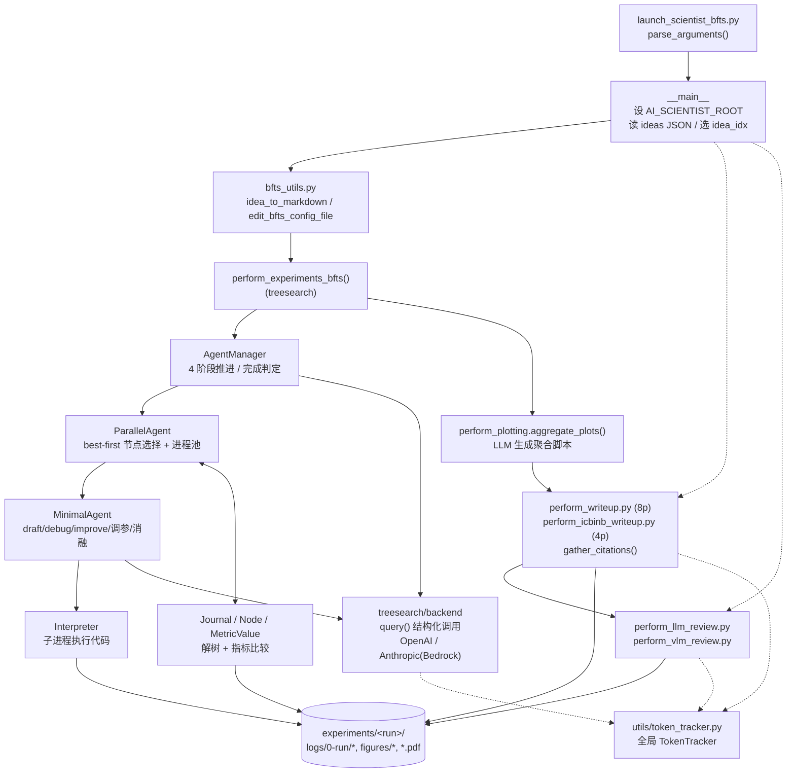
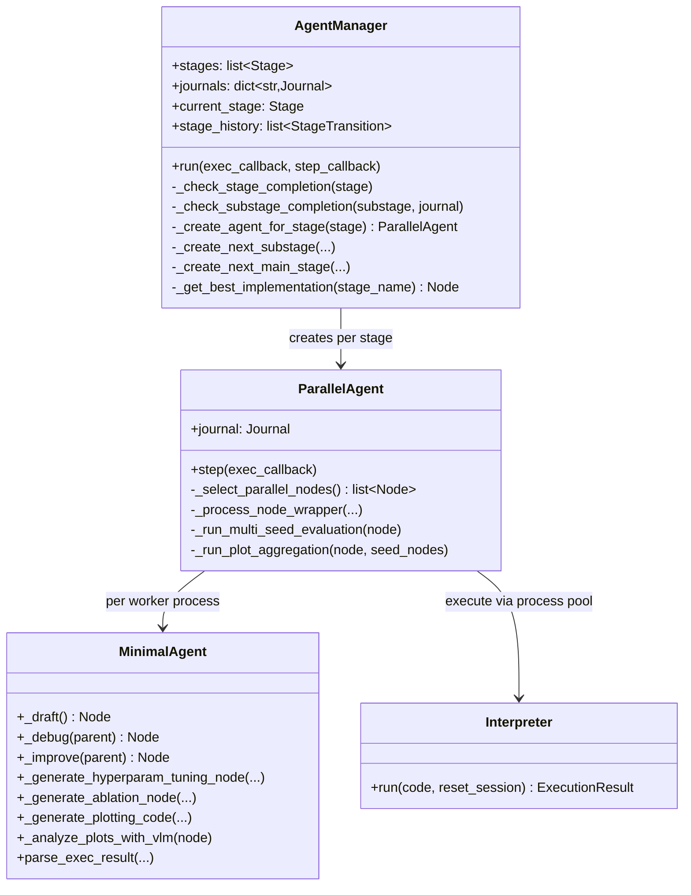

# The AI Scientist-v2 — 系统架构（BFTS / AIDE / AgentManager）

> 基于源码核验：`launch_scientist_bfts.py`、`ai_scientist/treesearch/*`、`ai_scientist/llm.py`、`vlm.py`。

---

## 1. 架构总览

v2 是"**编排器 + 树搜索子系统 + 多模型写作/评审 + 文件状态**"的分层系统：

1. **编排层**：`launch_scientist_bfts.py`（`__main__`）负责单想法的完整生命周期：想法→配置改写→实验→聚合图→写作→评审→进程清理。
2. **树搜索层（`treesearch/`，AIDE 派生）**：`perform_experiments_bfts()` 启动 `AgentManager`；`AgentManager` 按阶段创建 `ParallelAgent`；`ParallelAgent` 用 best-first 策略从 `Journal` 选节点，派 `MinimalAgent` 生成代码，`Interpreter` 子进程执行；`MetricValue` 比较节点优劣。
3. **认知服务层**：`backend/`（AIDE 的 LLM 抽象，支持 function calling）用于树搜索内部决策；`ai_scientist/llm.py`/`vlm.py`（带 `TokenTracker`）用于想法生成、写作、评审、图表分析。
4. **产物层**：`experiments/<run>/` 下的 `idea.md`、`bfts_config.yaml`、`logs/0-run/`（各阶段 journal、summary、tree_plot.html）、`figures/`、LaTeX/PDF、评审 JSON、token 统计。

### 1.1 总体 Mermaid 架构图



---

## 2. BFTS 树搜索核心（`treesearch/`）

### 2.1 数据结构：`Node` 与 `Journal`（journal.py）

**`Node`**（`journal.py:44`）是解树中的一个解（一段实验代码 + 执行结果 + 评估）。关键字段分组：

| 分组 | 字段 | 含义 |
| --- | --- | --- |
| 代码与计划 | `plan`, `overall_plan`, `code`, `plot_code`, `plot_plan` | 实验思路与实现、绘图代码 |
| 拓扑 | `id`(uuid4 hex), `step`, `parent`, `children`(set), `ctime` | 构成树；`__post_init__` 自动把自身加入 parent.children |
| 执行 | `_term_out`, `exec_time`, `exc_type/info/stack` | 主实验代码子进程执行结果 |
| 指标解析 | `parse_metrics_plan/code`, `parse_term_out`, `parse_exc_*` | 由 LLM 生成的"从 .npy 解析指标"代码及其执行 |
| 绘图执行 | `plot_term_out`, `plot_exec_time`, `plot_exc_*` | 绘图代码执行结果 |
| 评估 | `metric`(MetricValue), `analysis`, `is_buggy`, `is_buggy_plots` | 是否有 bug、指标、训练分析 |
| 图表/VLM | `plots`, `plot_paths`, `plot_analyses`, `vlm_feedback_summary`, `datasets_successfully_tested` | 图文件与 VLM 分析 |
| 特殊用途 | `ablation_name`, `hyperparam_name`, `is_seed_node`, `is_seed_agg_node`, `exec_time_feedback` | 消融/调参/多种子评估标记 |

关键属性/方法：
- `stage_name`（`:159`）：父为 None → `"draft"`；父 is_buggy → `"debug"`；否则 `"improve"`。
- `is_leaf`（`:192`）：无 children。`debug_depth`（`:203`）：连续 debug 层数（用于剪枝）。
- `absorb_exec_result` / `absorb_plot_exec_result`（`:170/:178`）：把 `ExecutionResult` 吸收进节点。
- `to_dict`/`from_dict`（`:214/:294`）：序列化（跨进程传递节点；`from_dict` 可传 `journal` 以恢复父子关系）。`__deepcopy__` 特意断开 parent/children 防止循环引用。

**`Journal`**（`journal.py:362`）是所有 Node 的有序集合（每阶段一个）：
- `append(node)`：设置 `node.step = len(nodes)` 并追加。
- `draft_nodes`（parent is None）、`buggy_nodes`（is_buggy）、`good_nodes`（`is_buggy is False and is_buggy_plots is False`）。
- `get_best_node(only_good=True, use_val_metric_only=False, cfg=None)`（`:420`）：**best-first 的核心**。先筛 good/buggy，节点>1 时用 LLM（function calling `node_selection_spec`）综合 metric/analysis/VLM 反馈选最佳；失败回退 `max(nodes, key=lambda n: n.metric)`。可用 `cfg.agent.select_node` 指定模型，默认 `gpt-4o`。
- `generate_summary(include_code=False, **model_kwargs)`（`:504`）：把成功/失败实验喂给 LLM 生成"记忆摘要"，供后续 step 使用。
- `save_experiment_notes`（`:565`）：落盘实验笔记。

### 2.2 指标比较：`MetricValue`（utils/metric.py）

- `MetricValue(value, maximize=None, name=None, description=None)`（`:114`）：`value` 可为单个数，或 `{"metric_names":[{metric_name, lower_is_better, description, data:[{dataset_name, final_value, best_value}]}]}`（新格式，多指标多数据集）。
- `__gt__`（`:171`）基于 `get_mean_value()` 与 `_should_maximize()`（新格式取第一个指标的 `lower_is_better` 取反）比较"谁更好"，而非单纯比数值大小。
- `get_mean_value()`（`:302`）对新格式取所有 dataset 的 `final_value` 均值。
- `WorstMetricValue`（`:328`）value=None，永远比任何有效指标差——**用于标记 buggy 节点，使其在选择/剪枝中自然被淘汰**。

### 2.3 Agent 分层：`AgentManager` → `ParallelAgent` → `MinimalAgent`



- **`AgentManager`**（`agent_manager.py:123`）：实验"总导演"。维护 `main_stage_dict`（1 initial_implementation、2 baseline_tuning、3 creative_research、4 ablation_studies）与 `main_stage_goals`；每个阶段可拆多个子阶段；每个子阶段建一个 `ParallelAgent`。详见 `pipeline_and_dataflow.md`。
- **`ParallelAgent`**（`parallel_agent.py:1142`）：在单个（子）阶段内做 best-first 扩展。`_select_parallel_nodes` 每轮挑 `num_workers` 个节点（None=新草稿、buggy 叶=debug、good=improve，阶段 2/4 换成调参/消融起点）；用进程池 `executor.submit(_process_node_wrapper, ...)` 并行处理；`GPUManager` 给 worker 分配 GPU。
- **`MinimalAgent`**（`parallel_agent.py:254`）：真正"写代码"的 agent（运行在 worker 进程）。提供 draft/debug/improve、超参调优节点、消融节点、绘图代码生成、指标解析、VLM 图表分析等。
- **`Interpreter`**（`interpreter.py:81`）：在独立进程执行 LLM 生成的代码，`run(code, reset_session=True)` 返回 `ExecutionResult(term_out, exec_time, exc_type, exc_info, exc_stack)`；含超时与 traceback 汇总。

### 2.4 AIDE 集成边界与本地化

`treesearch/` 的代码结构（`backend/query`、`FunctionSpec`、`Journal`/`Node`、`Interpreter`、`response.py`、`serialize.py`、`tree_export.py`）来自 AIDE（WecoAI/aideml）。v2 在其上定制：
- `backend/__init__.py:query()`：统一 LLM 调用，`claude-` 走 `backend_anthropic`（AnthropicBedrock），其它走 `backend_openai`（支持 `ollama/` 本地）；对 `o1*` 模型做特殊处理（system 合并进 user、`reasoning_effort=high`、`max_completion_tokens=100000`、去掉 temperature）。**注意 anthropic 后端目前不支持 function calling（`raise NotImplementedError`）**，所以结构化决策依赖 OpenAI 系模型。
- `FunctionSpec`（backend/utils.py:106）：把 JSON Schema 转成 OpenAI tool 定义，强制 function call 输出结构化决策（如 `node_selection_spec`、`stage_completion_eval_spec`）。
- 新增 `AgentManager` 阶段管理、多数据集 `MetricValue`、`log_summarization`、VLM 反馈、图聚合等本仓库特有逻辑。

---

## 3. 后端与模型分工（两套 LLM 通道）

| 通道 | 模块 | 用途 | 特点 |
| --- | --- | --- | --- |
| AIDE backend `query()` | `treesearch/backend` | 树搜索内部：节点选择、阶段完成判定、指标解析、摘要 | 支持 function calling；模型由 `bfts_config.yaml` 的 `agent.code/feedback/vlm_feedback`、`report`、`select_node`、`summary` 决定 |
| ai_scientist `llm.py` | `ai_scientist/llm.py` | 想法生成、写作、评审、图聚合 | 带 `@track_token_usage` 统计；模型由 CLI 参数传入 |
| `vlm.py` | `ai_scientist/vlm.py` | 图像输入调用（图表分析、图像审稿） | `get_response_from_vlm`/`get_batch_responses_from_vlm` |

`TokenTracker`（`utils/token_tracker.py:10`）全局单例 `token_tracker`：`add_tokens`/`add_interaction`/`get_summary`（含 `cost (USD)`，内置 `MODEL_PRICES` 表），在 `llm.py`/`vlm.py` 的四个函数上以装饰器记录；`launch_scientist_bfts.py` 的 `save_token_tracker()` 把 summary 与 interactions 写到 idea 目录。

---

## 4. 状态与产物布局

一次 `launch_scientist_bfts.py` 运行在 `experiments/<date>_<Name>_attempt_<id>/` 下产生：

```
<run>/
├── idea.md                          # 由 idea JSON 转的可读任务描述（含可选 Code）
├── idea.json                        # 该想法原始数据（可能加 Code 字段）
├── bfts_config.yaml                 # 复制自根配置并重定向 desc_file/workspace_dir/data_dir/log_dir
├── data/                            # 空数据目录（edit_bfts_config_file 创建）
├── logs/0-run/                      # prep_cfg 生成的实际 log_dir（exp_name 为 "0-run"）
│   ├── stage_1_initial_implementation_1_preliminary/
│   │   ├── journal.json / config.yaml / tree_plot.html
│   │   ├── best_solution_<id>.py / best_node_id.txt
│   │   └── notes/node_<id>_summary.json / stage_progress.json
│   ├── stage_2_.../ stage_3_.../ stage_4_.../   # 各阶段同上
│   ├── experiment_results/          # 每节点代码/数据/图（实验阶段临时）
│   ├── unified_tree_viz.html        # 跨阶段统一树可视化
│   ├── manager.pkl                  # AgentManager 状态（失败时降级为 journals）
│   ├── draft_summary.json / baseline_summary.json / research_summary.json / ablation_summary.json
│   ├── figures/                     # aggregate_plots 产出的最终图
│   └── auto_plot_aggregator.py      # LLM 生成的聚合脚本
├── <run名>.pdf                      # 最终论文（reflection 版本另存）
├── cached_citations.bib             # 引用缓存
├── review_text.txt                  # LLM 文本评审
├── review_img_cap_ref.json          # VLM 图/标题/引用一致性评审
└── token_tracker.json / token_tracker_interactions.json
```

> 路径细节：`bfts_config.exp_name` 默认 `run`，`prep_cfg` 会用日志/工作区目录索引加前缀生成 `0-run`；`edit_bfts_config_file` 把 `workspace_dir`/`log_dir` 都指向 idea 目录，故实际日志在 `<run>/logs/0-run/`。

---

## 5. 容错与清理

- `perform_experiments_bfts` 注册 `atexit.cleanup`：若 global_step==0（未真正开始）删除 workspace；`try/except` 保证即使树搜索失败也保存 journal/config/tree。
- `manager.pkl` 保存优先完整 manager，失败降级为 `journals.items()`。
- `AgentManager._save_checkpoint` 在每主阶段结束写 `checkpoint.pkl`（journals/stage_history/task_desc/cfg/...）。
- `launch_scientist_bfts.py` 结尾用 `psutil` 递归 SIGTERM 子进程（含含 `python/torch/mp/bfts/experiment` 关键字的孤儿进程），超时 3 秒后 SIGKILL，最后 `sys.exit(0)`。

算法细节与阶段切换见 [`pipeline_and_dataflow.md`](pipeline_and_dataflow.md)；函数签名见 [`modules_reference.md`](modules_reference.md)。
