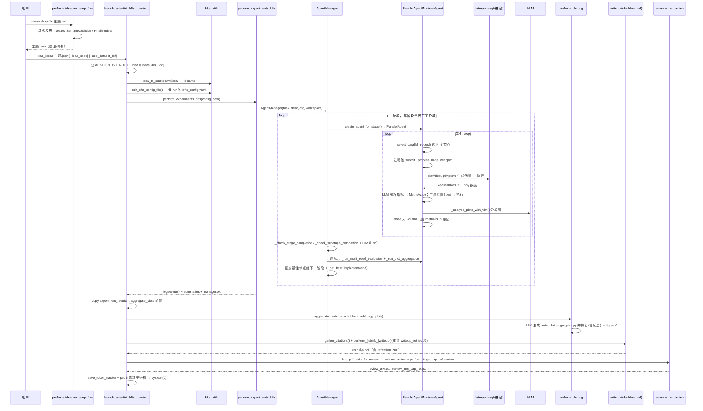

# The AI Scientist-v2 — 流水线与数据流

> 基于源码核验：`perform_ideation_temp_free.py`、`launch_scientist_bfts.py`、`treesearch/*`、`perform_plotting.py`、`perform_[icbinb_]writeup.py`、`perform_llm_review.py`、`perform_vlm_review.py`。

---

## 0. 端到端时序图

---

## 1. 阶段一：无模板想法生成（`perform_ideation_temp_free.py`）

**与 v1 的本质区别**：不需要 `experiment.py`/`seed_ideas.json`，只从一个高层主题描述（workshop `.md`）出发。

**输入**：`--workshop-file`（默认 `ai_scientist/ideas/i_cant_believe_its_not_better.md`）、`--model`、`--max-num-generations`、`--num-reflections`。主题 `.md` 建议含 `Title/Keywords/TL;DR/Abstract`（见 `ideas/i_cant_believe_its_not_better.md`）。

**工具（tools）**：
- `SemanticScholarSearchTool`（继承 `BaseTool`，`tools/semantic_scholar.py`）：`use_tool(query)` 调 `search_for_papers` 返回格式化论文。
- `FinalizeIdea`（字典形式的工具描述）：产出 IDEA JSON。

**`generate_temp_free_idea(idea_fname, client, model, workshop_description, max_num_generations=20, num_reflections=5, reload_ideas=True)`**（`perform_ideation_temp_free.py:128`）流程：
1. 若 `idea_fname`（由 `.md` → `.json`）已存在，`reload_ideas=True` 时加载已有想法作为去重上下文。
2. 每个想法最多 `num_reflections` 轮：
   - 第 1 轮用 `idea_generation_prompt`（主题 + 已有想法）；
   - 后续用 `idea_reflection_prompt`（含上次工具结果 `last_tool_results`）；
   - LLM 按 `system_prompt` 输出 `ACTION:` + `ARGUMENTS:`：
     - `ACTION=SearchSemanticScholar` → 调工具，把结果塞进 `last_tool_results`；
     - `ACTION=FinalizeIdea` → 解析 `{"idea": {...}}` 追加到 archive 并结束该想法。
   - 系统提示强制"finalize 前至少做一次文献检索"。
3. 写回 `idea_fname`（JSON 数组）。每个想法字段：`Name`、`Title`、`Short Hypothesis`、`Related Work`、`Abstract`、`Experiments`（list）、`Risk Factors and Limitations`（list 或 str）。

> 这些字段正是后续 `AgentManager.__init__` 强制校验的 5 个键（Title/Abstract/Short Hypothesis/Experiments/Risk Factors and Limitations）来源——**手动构造 ideas JSON 时也必须包含它们**。

---

## 2. 阶段二：入口准备（`launch_scientist_bfts.__main__`）

1. `os.environ["AI_SCIENTIST_ROOT"] = 仓库根`（供内部路径使用）。
2. 读 `--load_ideas` JSON，`idea = ideas[args.idea_idx]`；`idea_dir = experiments/<date>_<Name>_attempt_<id>`（`--attempt_id` 区分并行重复）。
3. `--load_code`：读取与 ideas JSON 同名 `.py` 作为可选起始代码；`--add_dataset_ref`：读取根目录 `hf_dataset_reference.py`（若存在）；二者拼接后写入 `idea["Code"]`（不存在则警告并置空）。
4. `bfts_utils.idea_to_markdown(idea, idea_dir/idea.md, code_path)`：把 idea 各字段转成 `## Header` 的 Markdown，若有 code 追加 "## Code To Potentially Use" 代码块。
5. 存 `idea.json`；`edit_bfts_config_file(bfts_config.yaml, idea_dir, idea.json)`：复制配置到 idea 目录，设置 `desc_file=idea.json`、`workspace_dir=idea_dir`、创建空 `data/`、`log_dir=idea_dir/logs`。

**数据流要点**：任务描述以 **JSON 字符串**形式经 `desc_file` 进入 `load_task_desc()`，再在 `AgentManager.__init__` 里 `json.loads(task_desc)`；`backend.compile_prompt_to_md` 把它转成 Markdown 供 LLM 使用。

---

## 3. 阶段三：4 阶段实验推进（`perform_experiments_bfts` + `AgentManager`）

### 3.1 `perform_experiments_bfts(config_path)`（perform_experiments_bfts_with_agentmanager.py:58）
- `load_cfg` → `load_task_desc` → `prep_agent_workspace`（建 `<workspace>/input` 和 `working`，`copytree(data_dir,...)` 按 `copy_data` 决定复制或符号链接）。
- 创建 `AgentManager(task_desc, cfg, workspace_dir)`。
- 定义 `exec_callback`（包装 `interpreter.run`，更新 Rich 状态）、`step_callback`（每步写 `notes/node_<id>_summary.json` + `stage_progress.json`，并 `save_run` 保存 journal/config/tree/best_solution）。
- `manager.run(exec_callback, step_callback)` 跑完全部阶段。
- 保存 `manager.pkl`；若 `cfg.generate_report=True`，`overall_summarize(manager.journals.items(), cfg)` 产出 4 份 summary JSON（draft/baseline/research/ablation）。

### 3.2 AgentManager 的 4 个主阶段

`main_stage_dict`（`agent_manager.py`）：
| 阶段 | 名称 | 目标（`main_stage_goals`） |
| --- | --- | --- |
| 1 | `initial_implementation` | 用简单数据集拿到**可运行的基本实现**（若有 "Code To Use" 可直接用） |
| 2 | `baseline_tuning` | 调超参（lr/epochs/batch size），**不改模型架构**；引入 2 个新的 HuggingFace 数据集测试 |
| 3 | `creative_research` | 探索新颖改进、揭示新洞察；共使用 3 个 HuggingFace 数据集 |
| 4 | `ablation_studies` | 系统组件分析，使用与上一阶段相同的数据集 |

**`run()` 主循环**（`agent_manager.py:692`）——外层主阶段 + 内层子阶段：
1. 对每个（子）阶段用 `_create_agent_for_stage()` 建 `ParallelAgent`（传入 `_curate_task_desc`：阶段 3 追加 Experiments 计划、阶段 4 追加 Risk Factors；并把上一阶段最佳实现作为 `best_stage1/2/3_node`）。
2. 若 `stage_history` 非空，把上一个阶段的最佳节点（deepcopy，断开 parent/children）追加进当前 journal——**这就是跨阶段"继承起点"**。
3. 每步 `agent.step(exec_callback)` → `step_callback` → `_check_stage_completion`：
   - 达标（或到 max_iterations）：对最佳节点跑 `_run_multi_seed_evaluation`（多种子复现）+ `_run_plot_aggregation`（聚合图），然后结束该主阶段。
   - 未达标则 `_check_substage_completion`：若完成，用 `_generate_substage_goal`（LLM 依据 metrics/issues/progress 生成）建新**子阶段**，记录 `StageTransition`，换新 `ParallelAgent` 继续。
4. 主阶段结束后 `_save_checkpoint()`，用 `_create_next_main_stage` 进入下一主阶段；阶段 4 完成后 `current_stage=None` 退出。
5. **阶段 1 若到 max_iterations 仍无可运行实现 → 直接结束整个实验**（`_check_stage_completion` 里置 `current_stage=None`）。

### 3.3 完成判定细节
- **阶段 1**：`len(journal.good_nodes)>0`（找到可运行实现）即完成。
- **阶段 2**：最佳节点必须优于 base 节点（journal.nodes[0]），并用 VLM 反馈 + 数据集测试情况让 LLM 判定"曲线稳定收敛、≥2 数据集、无重大不稳定"。
- **阶段 3**：最佳节点须优于 base；若已过半迭代且实验运行 < `exec.timeout/2`，写 `exec_time_feedback` 要求放大实验规模（更多 epoch/更大模型/更大数据集），返回未完成继续迭代。
- **阶段 4**：跑到 max_iterations 即可（`pass`）。
- 所有阶段 `len(journal.nodes) >= stage.max_iterations` 强制完成；子阶段完成判定 `_check_substage_completion` 用 VLM 反馈 + 目标让 LLM 判 `is_complete`。

---

## 4. 阶段四：树搜索一步的细节（回溯与剪枝）

`ParallelAgent.step(exec_callback)`（`parallel_agent.py:2053`）：

### 4.1 选节点 `_select_parallel_nodes()`（`:1931`）—— best-first + 回溯/剪枝
每轮选 `num_workers` 个待处理节点，`None` 表示新建草稿（初始树）：
1. 若草稿树数 < `search.num_drafts` → 追加 `None`（种下新根）。
2. **剪枝**：`viable_trees` 只保留"至少一个叶节点非 buggy"的树；整树全 buggy 的分支不再扩展（等价回溯放弃该路径）。
3. **debug 分支**：以 `search.debug_prob` 概率，从 `buggy_nodes` 中选"叶节点且 `debug_depth <= max_debug_depth`"的节点调试；超限的坏节点被剪掉（不再深挖）。
4. 阶段 2 直接用 `best_stage1_node` 作起点（调参）；阶段 4 用 `best_stage3_node` 作起点（消融）。
5. 阶段 1/3 走 best-first：`journal.get_best_node(cfg)` 选最优 good 节点；若其所属树已在本轮处理过，则按 metric 降序尝试其它树的最佳节点——**保证多样本并行不重复同一树**。

### 4.2 处理节点 `_process_node_wrapper()`（`:1410`，运行在 worker 进程）
1. 建进程私有 workspace（`<workspace>/process_<name>/working`），按 `gpu_id` 设 `CUDA_VISIBLE_DEVICES`（无 GPU 设空串走 CPU）。
2. 从 `node_data` 重建 parent 节点；新建 `MinimalAgent` 和 `Interpreter`。
3. 依据 parent 状态生成 child：`None`→`_draft()`；buggy→`_debug()`；good→阶段 2 用 `_generate_hyperparam_tuning_node`、阶段 4 用 `_generate_ablation_node`、否则 `_improve()`。
4. `interpreter.run(child_node.code, True)` 执行 → `parse_exec_result` 吸收到节点。
5. **指标解析**：若无 `.npy` 数据文件 → 告警；否则（非 seed_eval）让 LLM 写 `parse_metrics_code`（从 `experiment_data.npy` 读各数据集指标），执行后用 `metric_parse_spec` function call 提取 `metric_names`/`valid_metrics_received`，构造 `MetricValue`；无有效指标或解析异常 → `WorstMetricValue()` + `is_buggy=True`（**自动剪枝信号**）。
6. **绘图 + VLM**：非 buggy 节点生成绘图代码（最多重试 3 次），执行产生 `*.png` 存到 `logs/<run>/experiment_results/experiment_<id>_proc_<pid>/`，路径写入节点；`_analyze_plots_with_vlm()` 用 VLM 分析（>10 张图时先让 LLM 选 10 张），结果写入 `plot_analyses`/`vlm_feedback_summary`/`datasets_successfully_tested`。
7. 返回 `child_node.to_dict()`；主进程用 `Node.from_dict(result, journal)` 恢复父子关系并 `journal.append`。

### 4.3 多种子与聚合图
阶段完成时 `AgentManager.run` 调 `agent._run_multi_seed_evaluation(best_node)`（复用 best 节点代码/解析/绘图跑 `num_seeds` 次，产出 seed 节点）和 `agent._run_plot_aggregation(best_node, seed_nodes)`（汇总各 seed 结果），为写作准备稳健的统计结果。

---

## 5. 阶段五：图表聚合（`perform_plotting.aggregate_plots`）

- 入口由 `launch_scientist_bfts.py` 在复制 `experiment_results` 后调用：`aggregate_plots(base_folder=idea_dir, model=args.model_agg_plots)`。
- 读 `idea.md` + `logs/0-run/*_summary.json`，用 `filter_experiment_summaries(step_name="plot_aggregation")` 只保留 `overall_plan/analysis/plot_plan/plot_code/plot_analyses/vlm_feedback_summary/exp_results_npy_files` 等键。
- LLM（默认 `o3-mini-2025-01-31`）生成 `auto_plot_aggregator.py`，`run_aggregator_script` 在 `base_folder` 执行它产出 `figures/*.png`；随后 `n_reflections=5` 轮反思改进脚本（限制 `MAX_FIGURES`、检查标题/图例/去重等）。
- 之后删除临时 `experiment_results` 目录，`save_token_tracker` 落盘。

---

## 6. 阶段六：写作（normal / ICBINB）

`launch_scientist_bfts.py` 先 `gather_citations(idea_dir, num_cite_rounds, small_model=model_citation)`（缓存到 `cached_citations.bib`），再按 `--writeup-type` 调用（失败重试 `--writeup-retries` 次，默认 3）：
- `normal` → `perform_writeup(base_folder, small_model=model_writeup_small, big_model=model_writeup, page_limit=8, citations_text=...)`（ICML2025 模板 `blank_icml_latex`）。
- `icbinb`（默认）→ `perform_writeup`（`perform_icbinb_writeup.py`，ICLR2025 模板 `blank_icbinb_latex`，`page_limit=4`）。

**ICBINB 数据流（perform_icbinb_writeup.py:857）要点**：
1. 清理旧 latex/旧 PDF（含 `reflection` 字样的 PDF）。
2. `load_idea_text` + `load_exp_summaries`（读 `*_summary.json`）+ `filter_experiment_summaries(step_name="writeup")` 保留 `overall_plan/analysis/metric/code/plot_analyses/vlm_feedback_summary`。
3. 复制 `blank_icbinb_latex` 到 `latex/`；收集 `figures/*.png` 与 `auto_plot_aggregator.py` 作为上下文；注入 citations 到 `\end{filecontents}` 前。
4. 对每个图用 `generate_vlm_img_review` 生成图像描述（`desc_map`），供写作时准确描述图。
5. 用 `small_model` 起草、`big_model` 反思改进（多轮 `n_writeup_reflections`），`compile_latex` 编译。
6. **页数控制**：`check_page_limit`/`detect_references_position_clean`/`get_reflection_page_info` 检查是否超 `page_limit`；超页则生成 reflection PDF 并据 `img_cap_selection_prompt` 让 VLM 判断哪些图该移入附录/合并，再修订正文，产出 `*_reflection_*.pdf` 直至达标。
7. 成功返回 True，最终 PDF 名为 `<run目录名>.pdf`。

---

## 7. 阶段七：评审（文本 + VLM 视觉）

`launch_scientist_bfts.py` 若未 `--skip_review` 且未 `--skip_writeup`：
1. `find_pdf_path_for_review(idea_dir)`：优先带 `reflection` 且 `final` 的 PDF，其次编号最大的 reflection PDF。
2. `load_paper(pdf)` → `perform_review(paper_content, client_model, client)`（`perform_llm_review.py:125`，与 v1 类似的集成+反思评审，默认 1 轮）→ `review_text.txt`。
3. `perform_imgs_cap_ref_review(client, client_model, pdf_path)`（`perform_vlm_review.py:372`）：
   - `extract_figure_screenshots` 从 PDF 用 PyMuPDF 抽取每张图及对应 caption、正文中的 figref，存到 `<pdf名>_imgs/`；
   - `extract_abstract` 取摘要；
   - 每张图经 `generate_vlm_img_cap_ref_review`（VLM + `img_cap_ref_review_prompt`）产出 `Img_description/Img_review/Caption_review/Figrefs_review`；
   - 汇总写 `review_img_cap_ref.json`（`json.dumps(indent=4)`）。
4. 另有 `detect_duplicate_figures`（一次性把所有图发给 VLM 找重复）与 `perform_imgs_cap_ref_review_selection`（带页数限制的图选择评审）供写作 reflection 使用。

---

## 8. 数据流文件总表

| 阶段 | 读 | 写 |
| --- | --- | --- |
| 想法生成 | workshop `.md`, Semantic Scholar | `<主题>.json` |
| 入口准备 | ideas JSON, `.py`, `bfts_config.yaml`, `hf_dataset_reference.py` | `idea.md`, `idea.json`, `bfts_config.yaml`(run) |
| 树搜索实验 | `data/`, 各阶段配置 | `logs/0-run/stage_*/{journal.json,config.yaml,tree_plot.html,best_solution_*.py,notes/*}`、4 份 summary、manager.pkl |
| 图聚合 | summaries, idea.md | `auto_plot_aggregator.py`, `figures/*.png` |
| 写作 | idea.md, summaries, citations, figures | `latex/*`, `<run>.pdf`, `*_reflection_*.pdf` |
| 评审 | `<run>.pdf`(或 reflection PDF) | `review_text.txt`, `review_img_cap_ref.json` |
| 统计 | token 装饰器记录 | `token_tracker.json`, `token_tracker_interactions.json` |

---

## 9. 改流程时的注意事项（排错锚点）

- 改"跑几个节点/几轮阶段"：`bfts_config.yaml` 的 `agent.stages.stage{1..4}_max_iters`、`agent.steps`、`agent.search.num_drafts`（详见 execution_guide）。
- 改"阶段目标/推进规则"：`AgentManager.main_stage_goals`、`_check_stage_completion`、`_create_next_substage`。
- 改"选节点策略/剪枝"：`ParallelAgent._select_parallel_nodes`、`Journal.get_best_node`、`MetricValue.__gt__`。
- 加 VLM 分析：`ParallelAgent._analyze_plots_with_vlm`、`ai_scientist/vlm.py`。
- 阶段 2/4 依赖 `best_stage1/3_node`；若上一阶段无 best，`_create_agent_for_stage` 会抛 `ValueError` 或 `run()` 提前结束——调阶段顺序时要留意。
- Anthropic 后端不支持 function calling（`backend_anthropic.query` 抛 `NotImplementedError`）；结构化决策（节点选择/阶段判定/指标解析）需要 OpenAI 系模型。
